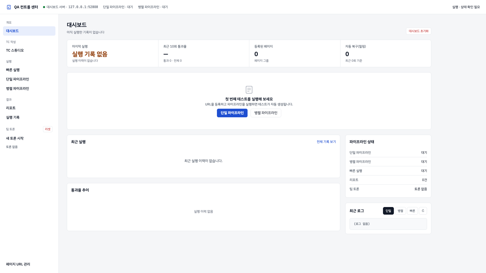
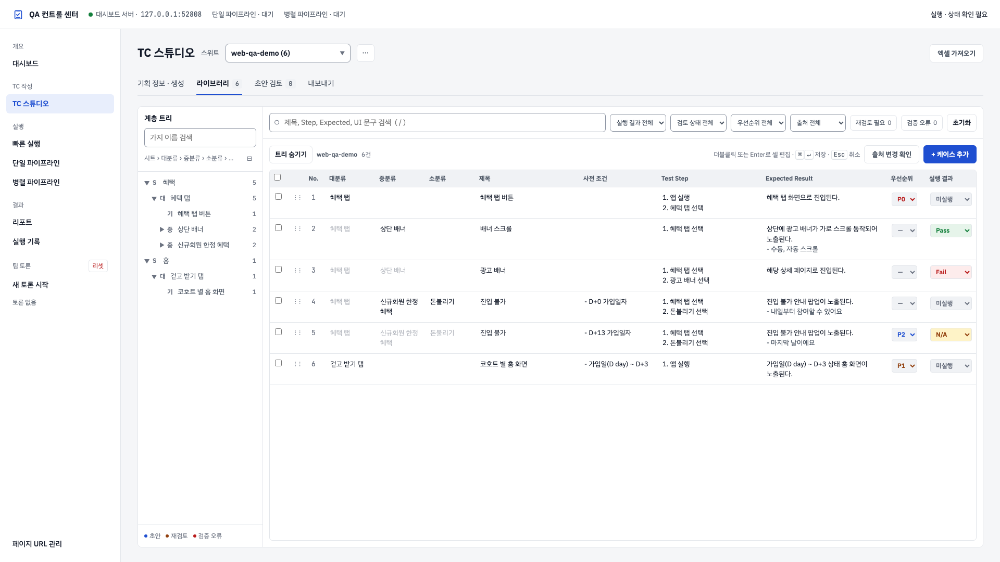
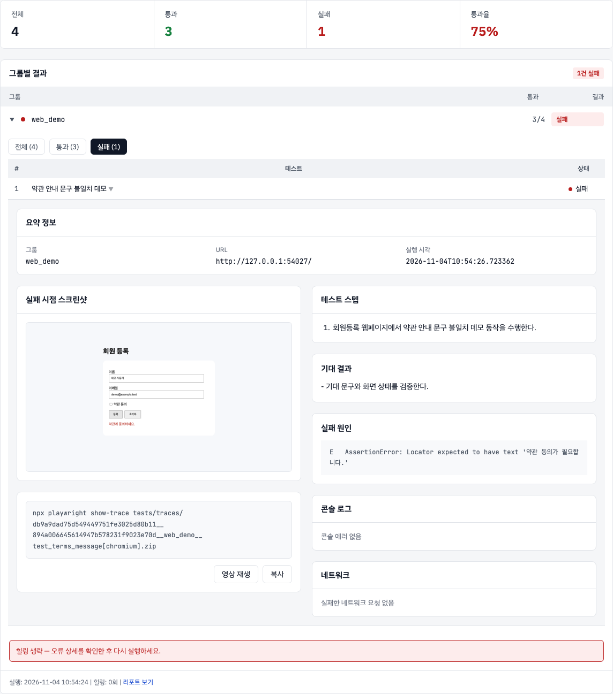
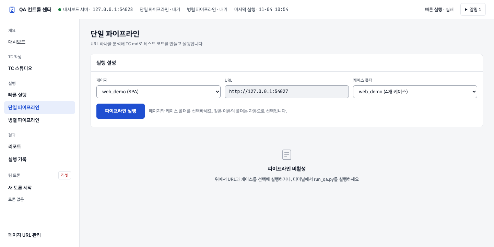
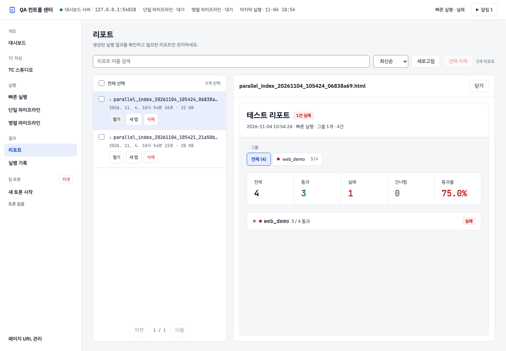
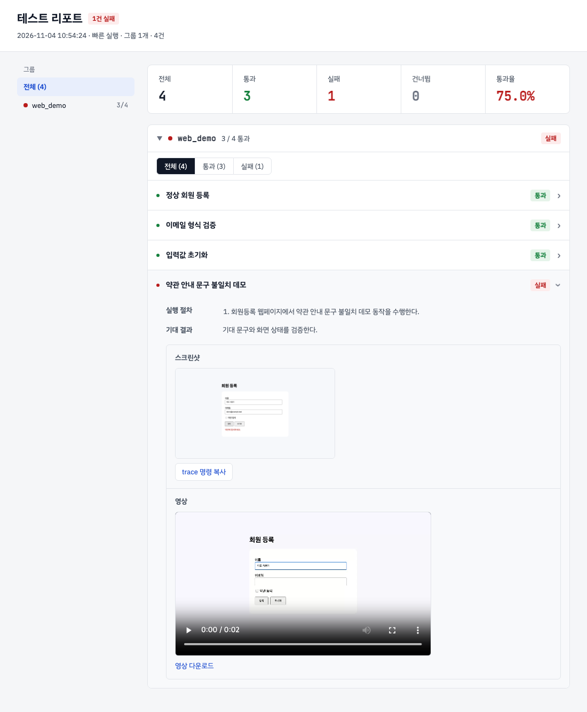
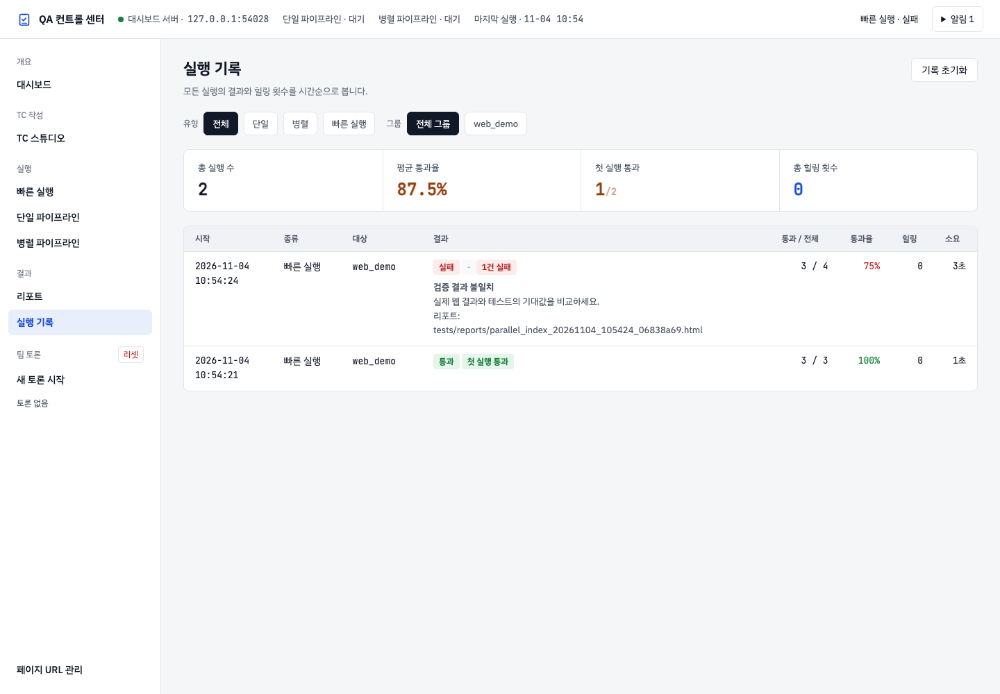

# QA Automation — Web

Playwright 기반 **웹 테스트 자동화 도구**입니다. 테스트 케이스 작성부터 DOM 분석, 코드 생성·검토, 실행과 실패 분석까지 로컬 웹 대시보드에서 진행합니다. 코드 생성과 LLM 기반 복구에는 로그인된 Claude Code CLI를 사용합니다.

[온보딩](ONBOARDING.md) · [빠른 시작](#빠른-시작) · [화면별 사용법](#화면별-사용법) · [운영 정책](#운영-정책과-오류-대응) · [CLI와 테스트 케이스](#cli와-테스트-케이스) · [개발 검증](#개발-검증) · [전체 문서](doc/README.md)

## 한눈에 보기

| 할 일 | 제공 기능 |
|---|---|
| 테스트 케이스 작성 | Excel 가져오기, 기획 정보로 초안 생성, 라이브러리 편집·검토 |
| 테스트 실행 | Markdown → DOM 분석 → pytest 코드 생성·검토 → Playwright 실행 |
| 여러 페이지 검증 | 그룹별 URL 설정, 단일·병렬 파이프라인, 생성된 코드 빠른 실행 |
| 실패 분석 | HTML 리포트, 실행 기록, 실패 스크린샷·영상·Playwright Trace |
| 협업·외부 연동 | 팀 토론, Confluence·Figma 기획 정보, 선택적 Jira 실패 보고 |

```text
TC 작성·가져오기 → Markdown 내보내기 → DOM 분석 → 코드 생성 → 검토 → 실행 → 결과 확인
                                                                               └─ 요소 오류일 때 자동 복구
```

웹 테스트 결과는 단일 기준으로 관리합니다. 대상 URL은 **페이지 URL 관리**, 테스트 입력값은 `test_data/`에서 설정합니다.



*로컬 회원등록 웹페이지를 실제 테스트한 결과입니다. 첫 실행은 3/3 통과, 두 번째 실행은 문구 불일치를 의도한 데모를 포함해 3/4 통과했습니다. 대시보드의 86%는 두 실행의 총 7건 중 6건 통과를 반올림한 값입니다. [실행·촬영 기준](doc/images/readme/README.md)을 참고하세요.*

<a id="설치"></a>

## 빠른 시작

### 1. 실행 환경 준비

저장소 루트에서 아래 명령을 실행합니다.

| 구분 | 준비할 항목 |
|---|---|
| 공통 | Python 3.12 이상, Node.js 18 이상 |
| 코드 생성·기획 초안·LLM 복구 | Claude Code CLI 설치·로그인 |
| 웹 테스트 | 설치 스크립트가 준비하는 Playwright Chromium, 접근 가능한 대상 URL |

```bash
npm install -g @anthropic-ai/claude-code
claude                          # 최초 로그인
```

Claude Code 이용 권한이 필요합니다. 별도의 LLM API 키는 요구하지 않습니다.

### 2. 의존성 설치

```bash
python3 scripts/setup_env.py
source .venv/bin/activate
```

설치 스크립트는 `.venv` 생성, Python 패키지·Chromium 설치, `test_data/*.example.json`의 실제 데이터 파일 복사를 수행합니다. 다시 실행해도 기존 테스트 데이터는 덮어쓰지 않습니다.

### 3. 테스트 대상과 입력값 설정

| 파일·화면 | 설정할 내용 |
|---|---|
| `config/pages.json` · 페이지 URL 관리 | 케이스 그룹별 테스트 URL |
| `testcases/{그룹}/tc_*.md` | 수행 단계·기대 결과·테스트 데이터 키 |
| `test_data/{프로덕트}.json` | 로그인 계정 등 실제 테스트 입력값 |
| `config/jira_config.json` | Jira 실패 보고를 사용할 때만 설정 |

실제 `test_data/{프로덕트}.json`은 Git에서 제외됩니다. 복사된 예시 값을 대상 환경에 맞게 수정하세요. 새 `data_key`의 빈 템플릿은 `python scripts/sync_test_data.py`로 보완할 수 있습니다. 자세한 규칙은 [TC 작성 가이드](doc/guides/TEST_CASE_GUIDE.html)를 참고하세요.

### 4. 대시보드 시작

```bash
.venv/bin/python agents/dashboard/serve.py
```

브라우저에서 **<http://localhost:8766>**을 엽니다. 대시보드를 실행한 컴퓨터에서 Claude Code CLI와 테스트 브라우저를 사용할 수 있어야 합니다.

### 5. 첫 테스트 실행

1. **TC 스튜디오**에서 Excel을 가져오거나 기획 정보로 초안을 만듭니다.
2. 내용을 확인하고 **내보내기**에서 그룹을 매핑해 Markdown으로 저장합니다.
3. **페이지 URL 관리**에서 해당 그룹의 URL을 확인합니다.
4. **단일 파이프라인**에서 URL·TC를 지정해 실행하거나 **병렬 파이프라인**에서 여러 그룹을 실행합니다.
5. **리포트** 또는 **실행 기록**에서 결과와 실패 증거를 확인합니다.

이미 pytest 코드가 생성되어 있다면 **빠른 실행**에서 해당 그룹을 선택해 다시 실행할 수 있습니다.

## 화면별 사용법

| 메뉴 | 주소 | 주요 용도 |
|---|---|---|
| 대시보드 | `/` | 최근 실행, 통과율 추이와 현재 상태 확인 |
| TC 스튜디오 | `/tc-studio` | 기획 입력, Excel 가져오기, 라이브러리·검토·내보내기 |
| 빠른 실행 | `/?view=quick_run` | 생성된 pytest 코드의 그룹별 재실행 |
| 단일 파이프라인 | `/?view=single_pipeline` | 지정한 URL·TC 분석부터 코드 생성·실행 |
| 병렬 파이프라인 | `/?view=parallel_pipeline` | 여러 그룹의 분석·코드 생성과 통합 실행 |
| 리포트 | `/?view=reports` | HTML 리포트 검색·미리보기·열기·삭제 |
| 실행 기록 | `/?view=history` | 실행별 결과, 실패·중단·시간 초과 원인 확인 |
| 새 토론 시작 | `/?view=team_new` | 팀 토론 주제 등록 |
| 페이지 URL 관리 | `/?view=pages` | 그룹별 테스트 URL 관리 |

상단 **QA 컨트롤 센터**를 누르면 대시보드로 돌아옵니다. 메뉴 주소는 새로고침과 뒤로/앞으로 이동에도 유지됩니다. 상세 조작은 [웹 QA 대시보드 사용자 가이드](doc/guides/USER_GUIDE.html)를 참고하세요.

### TC 스튜디오



*웹 회원등록 예시 4건을 Excel로 가져온 화면입니다. 라이브러리의 실행 상태는 미실행으로 유지되며, 실제 테스트 결과는 아래 빠른 실행·리포트에서 확인합니다. 표 전체를 보여 주기 위해 계층 트리를 숨겼습니다.*

<details>
<summary>Excel 가져오기·기획 초안·내보내기</summary>

- **엑셀 가져오기**에서 `.xlsx` 파일을 선택합니다. 양식·열 매핑, 시트와 스위트, 변경 미리보기를 확인한 뒤 가져옵니다. 파일당 최대 25MB입니다.
- **기획 정보 · 생성**에서 텍스트·파일·연결된 기획 정보를 입력하고 작성 위치를 지정합니다. 초안 생성에는 로그인된 Claude Code CLI가 필요합니다.
- **라이브러리**에서 계층 트리·검색·필터로 케이스를 찾고 내용을 수정합니다. 실행 결과는 웹 단일 기준입니다.
- **초안 검토**에서 내용과 출처를 확인하고 승인·반려합니다.
- **내보내기**에서 Excel을 받거나 그룹을 매핑해 Markdown 변경을 미리 확인하고 반영합니다. 원본 Excel은 변경하지 않습니다.

```text
로컬 Excel·기획 정보 → TC 라이브러리 → 검토·그룹 매핑
                                           └─ testcases/{그룹}/tc_*.md
                                                      └─ tests/generated/{그룹}/tc_*.py
```

전체 절차와 내보내기 제약은 [TC 스튜디오 사용자 설명서](doc/guides/tc-studio/TC_AUTHORING_USER_GUIDE.html)를 참고하세요. 초안 모델은 `TCS_CLAUDE_MODEL`, CLI 경로는 `TCS_CLAUDE_BIN`으로 지정할 수 있습니다. Confluence·Figma 연결 정보는 TC 스튜디오의 연결 설정에서 관리합니다.

</details>

### 파이프라인·빠른 실행



*빠른 실행의 결과 영역입니다. 전체 4건 중 3건 통과·1건 실패이며, **실패 (1)** 필터에서 해당 케이스를 펼쳐 실제 스크린샷과 실패 원인을 확인한 상태입니다. 의도적 기대 문구 불일치 데모이며 자동 복구는 생략했습니다.*

<details>
<summary>처음 실행할 때와 생성된 코드를 다시 실행할 때</summary>

**단일 파이프라인**은 URL과 TC를 지정해 DOM 분석·코드 생성·검토·실행을 진행합니다. **병렬 파이프라인**은 `config/pages.json`과 TC 그룹을 바탕으로 여러 대상을 처리하고 결과를 통합합니다. 생성·복구 과정의 로그에서 현재 단계와 오류를 확인할 수 있습니다.

**빠른 실행**은 이미 생성된 코드를 그룹별로 실행합니다. 목록이 비어 있으면 먼저 파이프라인으로 코드를 생성하세요.



*단일 파이프라인은 URL·TC를 선택한 실행 준비 화면입니다. 이번 촬영의 실제 테스트 실행은 빠른 실행으로 진행했으며, LLM 코드 생성·복구를 수행한 화면은 아닙니다.*

</details>

### 리포트·실행 기록



*제품이 실제 테스트 결과에서 생성한 HTML 리포트입니다. 의도적 실패 1건을 포함한 실행을 열었습니다.*

<details>
<summary>실패 증거·실행 기록·팀 토론</summary>

**리포트**에서 이름으로 검색하고 목록의 보고서를 미리 보거나 별도 창에서 엽니다. 길게 표시된 이름은 펼쳐 확인할 수 있습니다. 실패 TC의 오류와 보존된 스크린샷·영상·Trace를 함께 확인하세요.



*약관 안내 문구를 다르게 기대하도록 작성한 테스트의 실제 실패 증거입니다. 화면의 안내는 “약관에 동의하세요.”이며 테스트는 “약관 동의가 필요합니다.”를 기대했습니다.*

**실행 기록**에는 정상 완료 외에 리포트가 없는 시작 실패·시간 초과·중단도 남습니다. 같은 실행의 시각과 그룹을 기준으로 결과를 비교하세요.



**새 토론 시작**에서 주제를 입력해 팀 논의를 등록합니다. 토론 기록과 후속 처리는 [팀 토론 지침](doc/operations/TEAM_DISCUSSION.md)을 참고하세요.

</details>

## 운영 정책과 오류 대응

- **실행은 한 작업씩 진행합니다.** 단일·병렬 파이프라인과 빠른 실행의 중복 실행을 서버에서 차단합니다. 메뉴 이동과 브라우저 종료는 실행 취소가 아닙니다.
- **중단은 상단 실행 중단을 사용합니다.** 하위 프로세스 종료와 정리 작업이 끝난 뒤 결과를 확인합니다. 대시보드에서 시작한 작업의 전체 제한 시간은 3,600초입니다.
- **서버 재시작 시 살아 있는 작업을 추적합니다.** 남은 단계를 자동으로 새로 시작하지 않습니다.
- **재시도는 지정된 상태 조회·DOM 읽기에만 최대 3회 적용합니다.** 실행 요청·클릭·실패 테스트를 무조건 반복하지 않습니다.
- **요소 오류만 자동 복구 대상입니다.** 최신 DOM 수집에 실패하면 중단하며, 수정 검증 실패 시 원본 바이트를 복원하고 추가 실행을 멈춥니다.
- **오류 알림에서 원인과 다음 행동을 확인합니다.** 확인했어요는 현재 브라우저에서 알림을 숨기며 실행 결과를 삭제하지 않습니다.

<details>
<summary>Jira 실패 보고 설정</summary>

Jira 연동은 선택 사항입니다. `config/jira_config.json`에 아래 값을 설정합니다.

```json
{
  "base_url": "https://your-domain.atlassian.net",
  "email": "your@email.com",
  "token": "",
  "project_key": "SCRUM",
  "issue_type_id": "10003",
  "epic_key": "SCRUM-5",
  "auto_attach": true
}
```

토큰은 환경변수 `JIRA_TOKEN`으로도 지정할 수 있습니다. 통합 실행의 최종 실패를 Jira 이슈로 보고하고 설정에 따라 증거를 첨부합니다. 설정하지 않아도 테스트를 실행할 수 있습니다.

</details>

<details>
<summary>설치·실행 문제 해결</summary>

| 증상 | 원인 | 해결 |
|---|---|---|
| `state/pipeline.json 없음` | 파이프라인 초기화 미실행 | `run_qa.py` 또는 `run_qa_parallel.py` 재실행 |
| 생성 테스트 전부 실패 (`KeyError`/`FileNotFoundError`) | `test_data/{프로덕트}.json` 없음 (새 클론) | `cp test_data/{프로덕트}.example.json test_data/{프로덕트}.json` |
| `tests/generated/` 파일 없음 | subagent 코드 생성 미완료 | Claude Code에 subagent 재실행 요청 |
| 특정 케이스 FAIL | assertion / locator 오류 | 해당 `.py` 파일 직접 확인 후 수정, 또는 Healer 재실행 |
| 스크린샷 미생성 | conftest.py 중복 로드 | `tests/generated/` 하위에 conftest.py 없어야 함 |
| 자동 복구 중단 | 요소 수정 검증 실패 또는 복구 대상이 아닌 오류 | 원본 복원 여부와 실행 로그를 확인. 기대값 불일치는 실제 요구사항을 검토하고, 요소 오류는 최신 화면으로 진단 |
| `browser_snapshot` 도구 없음 | Playwright MCP 미설치 | `claude mcp add playwright -- npx -y @playwright/mcp@latest` 실행 후 재시작 |
| 병렬 힐링 후 lessons_learned 누락 경고 | 힐링 패치만 적용, 교훈 미기록 | `agents/lessons_learned.md`에 교훈 수동 기록 후 `99_merge.py` 재실행 (자동 로그는 `lessons_learned_auto.md`에 별도) |
| assertion 무결성 경고 (`9 → 7` 등) | 힐링 중 assertion이 단순화(약화)됨 | 경고 메시지의 파일·줄 번호 확인 후 원래 키워드 조건 체크(`assert any(keyword in text ...)`)로 복원 |
| `AttributeError: 'Namespace' object has no attribute 'no_report'` | `99_merge.py`에 `--no-report` 인자 누락 (구버전) | 최신 버전으로 업데이트 (`git pull`) |
| DOM 분석 실패 | 네트워크 / URL 오류 | URL 접근 가능 여부 확인 |

</details>

## CLI와 테스트 케이스

```bash
# 폴더 지정 (권장) — 폴더 내 tc_*.md 파일 전체를 자동 읽음
python run_qa.py --url https://example.com/login --cases testcases/login/

# 자동 실행 없이 안내만 출력 (기존 방식)
python run_qa.py --url https://example.com/login --cases testcases/login/ --no-auto
```

실행하면 headless Claude Code 세션이 백그라운드로 뜨고 파이프라인 전체를 자동 완주합니다.  
진행 로그는 `logs/run_qa_headless.txt`에서 확인할 수 있습니다.

### 테스트 케이스 작성

케이스는 `testcases/` 하위 그룹 폴더에 `.md` 파일로 작성합니다. **1파일 = 1케이스.**

```
testcases/
  {서비스명}/     ← 케이스 그룹 (URL은 config/pages.json 참조)
    tc_01_login_success.md
    tc_02_wrong_password.md
    ...
```

**케이스 파일 형식 (YAML frontmatter + Markdown):**

```markdown
---
id: tc_01
data_key: valid_user
priority: high
tags: [positive, smoke]
type: structured
---
# 정상 로그인 성공

## Precondition
0. 로그인 페이지 접속 상태

## Steps
1. username 필드에 test_data[valid_user].username 입력
2. password 필드에 test_data[valid_user].password 입력
3. Login 버튼 클릭

## Expected
- You logged into a secure area! 메시지가 표시되어야 한다.
```

- frontmatter 필수: `id`, `data_key`, `priority`, `tags`, `type`
- Steps 입력값은 `test_data[{data_key}].{속성}` 형식 (하드코딩 금지)

자세한 작성 규칙: [`doc/guides/TEST_CASE_GUIDE.md`](doc/guides/TEST_CASE_GUIDE.md)

### 병렬 파이프라인 직접 실행 (선택)

```bash
python run_qa_parallel.py
# pages.json + testcases/ 자동 스캔 → DOM 분석 → state/parallel_contexts.json 저장
# → headless Claude 세션이 subagents[] 동시 실행 + parallel/99_merge.py + 힐링까지 자동 완주
# 진행 로그: logs/run_qa_parallel_headless.txt

# 자동 실행 없이 안내만 출력 (기존 방식)
python run_qa_parallel.py --no-auto
# PARALLEL_SUBAGENT_CONTEXTS 출력 후 수동 실행 안내
```

## 주요 파일과 산출물

> 전체 디렉토리 트리: [`doc/reference/DIRECTORY.md`](doc/reference/DIRECTORY.md)

| 폴더 | 역할 |
|---|---|
| `scripts/` | 파이프라인 단계별 스크립트 + 훅 + 라이브러리 (Claude가 자동 호출) |
| `agents/` | 사수-부사수 역할, 팀 토론 로그, lessons_learned |
| `prompts/` | 심의 Agent 프롬프트 템플릿 |
| `state/` | 런타임 상태 파일 (pipeline.json, run_history.json 등) |
| `config/` | 설정 (`pages.json`, `pipeline.json`, `jira_config.json`(선택)) |
| `test_data/` | 프로덕트별 테스트 입력값 (`{프로덕트}.json`은 git 제외, `*.example.json`은 템플릿) |
| `testcases/` | 테스트 케이스 `.md` 파일 (그룹별 서브폴더) |
| `tests/` | 생성된 테스트 코드, 리포트, 스크린샷 · `tests/unit/`에 저장소 단위 테스트 |
| `.claude/skills/` | 스킬 프레임워크 (SKILL.md 표준) |

| 경로 | 내용 |
|---|---|
| `tests/generated/{그룹}/tc_*.py` | 생성된 pytest 코드 |
| `tests/reports/parallel_index_*.html` | 통합 HTML 리포트 |
| `tests/screenshots/` · `tests/videos/` | 테스트별 스크린샷·영상 |
| `tests/traces/` | Playwright Trace, `npx playwright show-trace <파일>.zip`으로 열기 |
| `state/` · `logs/` | 실행 상태·실행별 결과·로그 |

## 개발 검증

저장소 자체 회귀 테스트는 실제 대상 사이트에 접근하는 생성 테스트와 분리해 실행합니다.

```bash
source .venv/bin/activate
python -m playwright install chromium
python -m pytest tests/unit -q
```

문서를 수정했다면 링크·목차와 생성된 HTML도 확인합니다.

```bash
python scripts/build_user_guides.py --check
python -m pytest tests/unit/core/test_html_guides.py tests/unit/core/test_documentation_index.py tests/unit/core/test_doc_registry_sync.py -q
```

실제 대상 사이트 검증에는 접근 가능한 URL과 유효한 테스트 입력값이 필요합니다. `tests/generated/` 전체를 제품 코드 회귀 테스트 명령에 포함하지 않습니다.

## 관련 문서

| 문서 | 내용 |
|---|---|
| [전체 문서 안내](doc/README.md) | 목적별 문서 목록·갱신 기준 |
| [웹 QA 대시보드 사용자 가이드](doc/guides/USER_GUIDE.html) | 메뉴·실행·리포트·오류 대응 |
| [TC 스튜디오 사용자 설명서](doc/guides/tc-studio/TC_AUTHORING_USER_GUIDE.html) | 기획 입력·라이브러리·검토·내보내기 |
| [TC 작성 가이드](doc/guides/TEST_CASE_GUIDE.html) | Markdown 형식·필수 항목·예시 |
| [스크립트 사용 매뉴얼](doc/guides/SCRIPTS_GUIDE.html) | 실행 순서·단계별 스크립트 |
| [API·CLI 레퍼런스](doc/reference/API_REFERENCE.md) | 인자·엔드포인트·요청과 응답 |
| [복구 지침](doc/operations/HEALING_GUIDE.md) | 실패 진단·자동 복구 기준 |
| [화면 이미지 안내](doc/images/README.md) | 화면 캡처·촬영 시점·예시 데이터 출처 |
